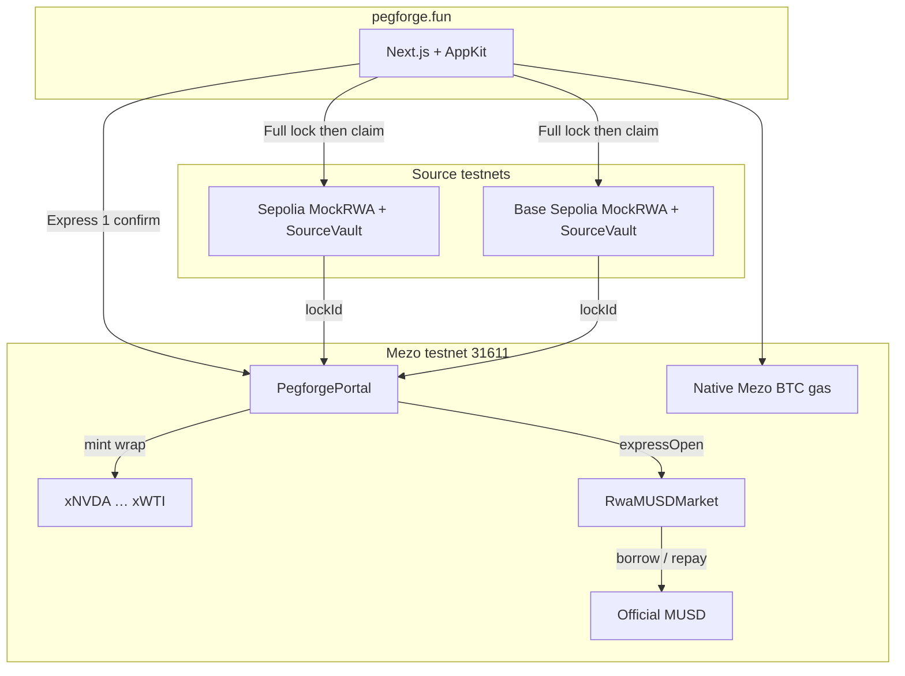
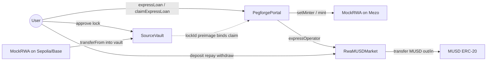
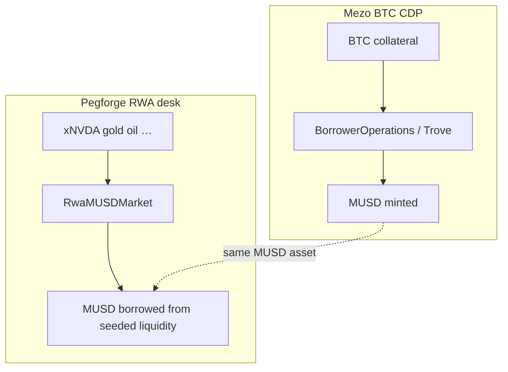
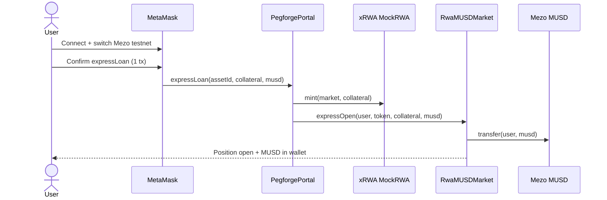
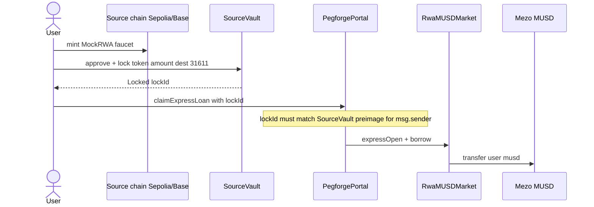
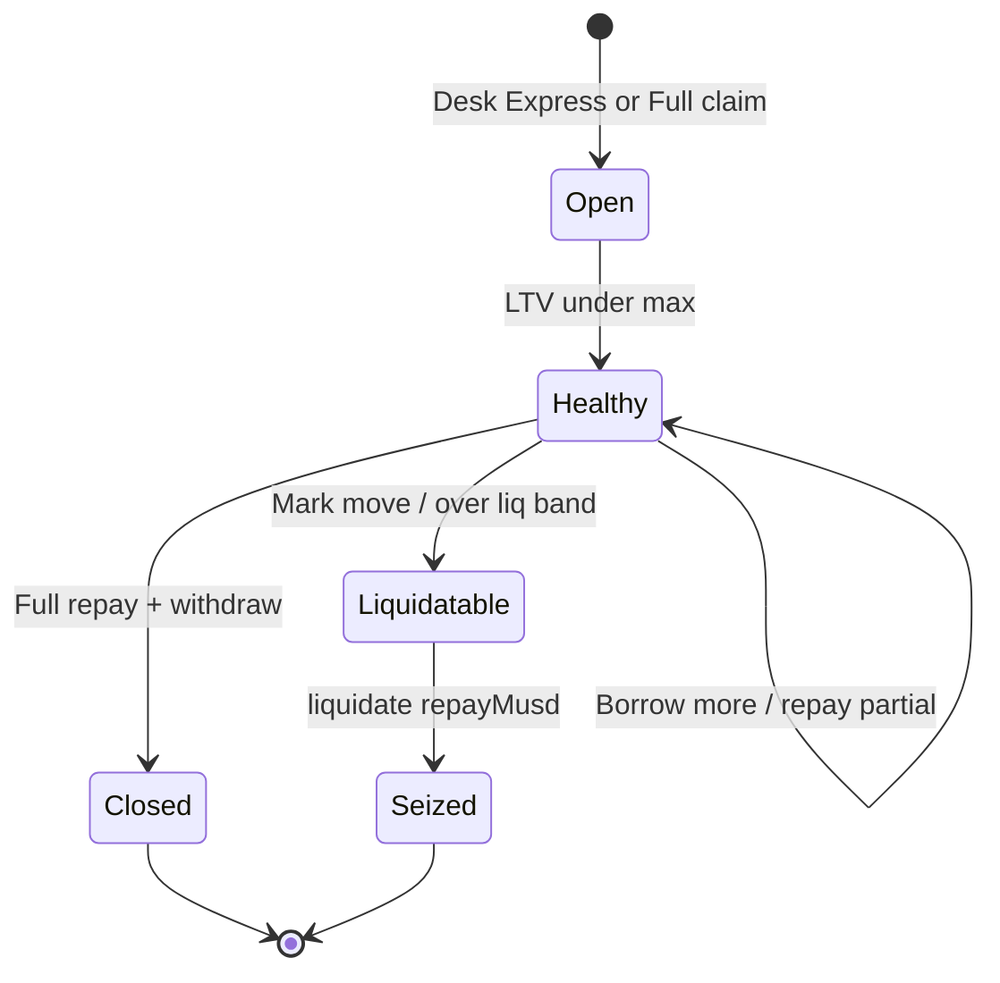
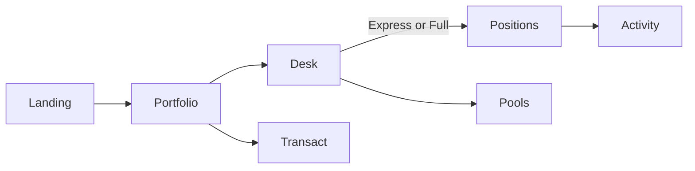
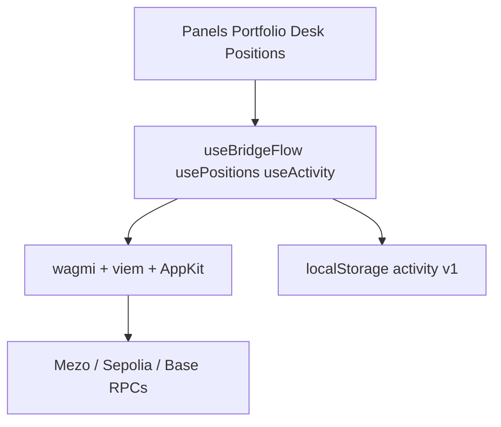

# pegforge.fun

**In two sentences:** Pegforge lets you post tokenized US equities, gold, silver, and oil as collateral on Mezo testnet and borrow [MUSD](https://mezo.org) without selling the upside. It extends Mezo’s BTC CDP pattern - lock collateral, mint/borrow MUSD, repay or liquidate - to RWA collateral with an Express desk (one MetaMask confirm) and a Full lock → claim path from Sepolia / Base Sepolia.

| Field | Value |
| --- | --- |
| **Track** | DeFi (borrowing / collateral / MUSD utility) |
| **Primary chain** | Mezo Testnet (`31611`) |
| **Also used** | Ethereum Sepolia (`11155111`), Base Sepolia (`84532`) |
| **How MUSD is used** | Borrowed against RWA collateral from `RwaMUSDMarket`; repaid in Positions; sent in Transact; seeded as desk liquidity |
| **Readiness** | Working **testnet** deployment + live UI |
| **Status** | New project built for Mezo Buildathon Wave 1 → Wave 2 |

---

## Links

| Resource | URL |
| --- | --- |
| Live app | https://pegforge.fun/ |
| Production domain | pegforge.fun (Vercel) |
| GitHub | https://github.com/AmaanSayyad/Pegforge |
| Docs / deck | https://docs.google.com/presentation/d/1v-qFfd9zo1iIgxf8qA5QQelKbGhm77qaKKT5u84V_o4/edit?usp=sharing |
| Demo video | https://drive.google.com/drive/folders/1E7IDlaauJUveBYRReMbSuH_9d9sgYQU9?usp=sharing |
| Mezo Buildathon (AKINDO) | https://app.akindo.io/communities/4eNwDP2DGT2akxqKK/products/gXlnD9PLoF14gj1X |
| Sourcify (Portal) | https://repo.sourcify.dev/contracts/full_match/31611/0xa64350F13010225585640E6af5acc3AF04480C2a/ |
| Deployer wallet | `0xF7249B507F1f89Eaea5d694cEf5cb96F245Bc5b6` |

---

## Story and inspiration

Mezo already lets Bitcoiners live off BTC without selling - lock BTC, mint MUSD. Meanwhile tokenized stocks and commodities (Ondo, xStocks, bStocks, Robinhood-style rails) are showing up on EVMs, but there is no clean desk on Mezo to post those assets and borrow the same Bitcoin-backed dollar.

Pegforge is that desk: **same CDP mental model as Mezo’s BTC market, new collateral surface for RWAs**, so more people can demand MUSD without dumping NVDA, gold, or oil.

---

## The problem

| Pain | Today |
| --- | --- |
| Holders of tokenized equities / metals / energy want liquidity | They sell the asset or leave Mezo |
| Mezo MUSD demand is BTC-centric | Stocks and commodities cannot open a Mezo-native MUSD loan |
| Multi-step bridge + wrap + deposit + borrow | Too many MetaMask pops for a demo / first loan |

---

## Solution

1. **Allowlist RWA wraps on Mezo** (`MockRWA` / xNVDA…xWTI) with per-asset LTV and liquidation bands.
2. **`RwaMUSDMarket`** - deposit collateral, borrow real Mezo testnet **MUSD** (`0x1189…Ac503`), repay, withdraw, liquidate.
3. **`PegforgePortal`**
   - **Express:** one Mezo tx (`expressLoan`) - wrap into market + borrow.
   - **Full:** lock on Sepolia/Base `SourceVault` → `claimExpressLoan` on Mezo bound to `lockId`.
4. **App surface:** Portfolio, Desk, Positions (MetaMask import), Activity, Transact (MUSD + Mezo BTC gas), Pools.

---

## Who it is for

| Persona | Need |
| --- | --- |
| Tokenized equity / metal holders | Borrow MUSD without selling upside |
| Mezo / Bitcoin DeFi users | Expand collateral beyond BTC |
| Builders integrating MUSD | Clear borrow / repay / transfer flows on testnet |

---

## Why now

| Signal | Why it matters |
| --- | --- |
| Mezo Buildathon focus on **MUSD utility** | Pegforge creates new MUSD borrow demand from RWAs |
| Tokenized RWAs are live on public EVMs | Collateral supply exists; Mezo needs a sink |
| Mezo BTC CDP already educates users | Same UX language transfers to stocks / gold / oil |
| Testnet BTC + openTrove MUSD | Demo can seed desk liquidity and ship end-to-end |

---

## Features

| Feature | Detail |
| --- | --- |
| Express Desk | One MetaMask confirm on Mezo - wrap + borrow MUSD |
| Full bridge path | Sepolia / Base lock → Mezo claim with `lockId` binding |
| 10 RWA markets | NVDA, AAPL, MSFT, AMZN, GOOGL, META, TSLA, gold, silver, WTI |
| Per-asset LTV / liq | e.g. mega-caps ~50%, gold ~65%, WTI / TSLA ~40% |
| Positions | Repay debt, withdraw collateral, MetaMask token import |
| Portfolio | Mezo BTC gas + MUSD + open loans |
| Activity | Tx history with explorer links |
| Transact | Send / receive MUSD and Mezo native BTC |
| Pools | Desk MUSD liquidity view + Mezo MUSD/BTC AMM pointer |
| Verified source | Sourcify `exact_match` on Mezo, Sepolia, Base Sepolia |

---

## How MUSD is used

| Step | MUSD role |
| --- | --- |
| Seed | Deployer mints MUSD via Mezo BTC trove / testnet flows and transfers into `RwaMUSDMarket` |
| Borrow | User opens RWA position → market transfers MUSD to wallet |
| Hold / spend | Portfolio + Transact + MetaMask import |
| Repay | Positions pulls MUSD back to market, frees collateral |
| Liquidate | Undercollateralized positions repay MUSD, seize collateral |

Native gas on Mezo is **official Mezo Bitcoin** (chain `31611`), not a custom gas token.

---

## Architecture

### System overview



### Contract relationships



### How Pegforge sits next to Mezo BTC CDP



### Express (Mezo-only)



### Full bridge (source lock → Mezo claim)



### Loan lifecycle



### App modules



### Frontend data flow



---

## Tech stack

| Layer | Choice |
| --- | --- |
| Frontend | Next.js 16, React 19, TypeScript, Tailwind CSS 4 |
| Motion / UI | Framer Motion, Lucide |
| Wallet | Reown AppKit + wagmi + viem |
| Contracts | Solidity `0.8.28`, Foundry |
| Chains | Mezo testnet, Sepolia, Base Sepolia |
| Stablecoin | Official Mezo testnet MUSD |
| Verification | Sourcify exact match |
| Hosting | pegforge.fun (production UI) |

---

## Contract addresses

### Core (Mezo testnet)

| Contract | Address |
| --- | --- |
| PegforgePortal | [`0xa64350F13010225585640E6af5acc3AF04480C2a`](https://explorer.test.mezo.org/address/0xa64350F13010225585640E6af5acc3AF04480C2a) |
| RwaMUSDMarket | [`0xF82263e2A01BF3977500CfD2A95A6B6d2103BF7B`](https://explorer.test.mezo.org/address/0xF82263e2A01BF3977500CfD2A95A6B6d2103BF7B) |
| MUSD (official) | [`0x118917a40FAF1CD7a13dB0Ef56C86De7973Ac503`](https://explorer.test.mezo.org/address/0x118917a40FAF1CD7a13dB0Ef56C86De7973Ac503) |

### Mezo wrapped RWAs (portal minter)

| Asset | Address |
| --- | --- |
| xNVDA | `0xD1EAA16e0a1689C1b4c4B4BD7a3Ff18eA2Cfd650` |
| xAAPL | `0x465c20d9b234D46B601153fDE1a55fAeC0b1569e` |
| xMSFT | `0xEa8860639d003c9B746B94d077D6dD5052e7cF5d` |
| xAMZN | `0xBdb5bDc633Dec3F7D288C1b93b775A80fFE1aD40` |
| xGOOGL | `0x15D7CaE32F552F4F81bCBe1B68F04869366b436A` |
| xMETA | `0x2CdA441bA79F54E1dE7c366dF09c260247941760` |
| xTSLA | `0x0FF14768c7598e6F287bfC6451B888c406dfD5Bd` |
| xGOLD | `0xe16E629C36427d00804027d569416f0f8928F3a2` |
| xSILVER | `0x88f6c41970274525B0dd9B07152Dbb4b596Bc94f` |
| xWTI | `0xfeAAa8c66A6b395256eA232036D8858f22d7bBa2` |

### Sepolia source

| Contract | Address |
| --- | --- |
| SourceVault | [`0x579C1Ef1387Ca3A80850CB1df38a33689509d357`](https://sepolia.etherscan.io/address/0x579C1Ef1387Ca3A80850CB1df38a33689509d357) |
| NVDAon | `0xc535F241CaDaFe0390Ef99cdb94F0f569f71C658` |
| AAPLx | `0x7019f2f987f91c6902b25614b9ccea8a4bf9d29b` |
| GOOGon | `0x42ea3dffd304ee8c2a7c3886175021700b3dd118` |
| METAx | `0x7397e86dbf9a4eacba0f5ae5f1ca180de3151380` |
| GOLDon | `0xdb7852e4b1ab6d102e5e0f4be668072225a65c00` |
| WTIon | `0xb2c79de2bd3d7cd6892fd1eadcf78ebe09ca6c65` |
| TSLAr | `0x486506794830f903025d3d19302a883f7d0edd68` |

### Base Sepolia source

| Contract | Address |
| --- | --- |
| SourceVault | [`0xbbd719534c41eef0094c6e460a7a9526c8bfcc85`](https://sepolia.basescan.org/address/0xbbd719534c41eef0094c6e460a7a9526c8bfcc85) |
| MSFTx | `0xf82263e2a01bf3977500cfd2a95a6b6d2103bf7b` |
| AMZNb | `0x899a1dff98c3ad911e626787a0e708812d2fd119` |
| SILVERx | `0xf6b4c0dd3355103523f031c8a1eae944a8145180` |

Full Sourcify links and redeploy notes: [`contracts/DEPLOY.md`](./contracts/DEPLOY.md).

---

## Competitive landscape

| Alternative | Gap vs Pegforge |
| --- | --- |
| Mezo BTC CDP alone | BTC-only collateral - no stocks / metals / energy |
| Generic RWA lending on ETH/Base | Not Mezo-native; does not expand **Mezo MUSD** demand |
| CEX stock loans | Custodial; no Mezo MUSD; no on-chain liquidation desk |
| DIY wrap + manual market | High friction; Pegforge packages Express + Positions + import |

**Positioning:** complementary to Mezo’s BTC CDP - more collateral types → more MUSD borrowers → more Bitcoin economy activity on Mezo.

---

## Business model and monetization

| Stream | Near-term | Later |
| --- | --- | --- |
| Origination / borrow fee | Off on testnet | Small bps on MUSD borrowed |
| Liquidation bonus | Protocol-defined seize spread | Keep / share with liquidators |
| Desk liquidity spread | Seeded demo pool | LP fee for MUSD suppliers |
| Integrations | - | Issuer / oracle / wallet partnerships |

Testnet build prioritizes **integration depth and demo clarity** over fee collection.

---

## Go to market

| Phase | Action |
| --- | --- |
| Now | Mezo Buildathon judges + Discord builders try Express on pegforge.fun |
| Wave 2 | Tight demo script, faucet notes, liquidation UI, oracle hardening narrative |
| After | Mezo Ignition / Founder programs; partner with RWA issuers for real wraps |
| Distribution | Mezo Discord, AKINDO, Twitter/X, founder network, demo day Nov 23 |

---

## Roadmap

| Milestone | Target |
| --- | --- |
| Wave 1 | Live Express + Full path, Portfolio / Positions / Activity, Sourcify publish |
| Wave 2 (Nov 2–15) | See plan below |
| Post-hackathon | Real attestation bridge, Chainlink/RWA oracles, mainnet Mezo |
| Scale | Allowlisted issuer tokens, LP vault for MUSD desk, liquidation bots |

---

## Wave 2 plan

| Workstream | Deliverable |
| --- | --- |
| Demo reliability | Auto refill / clearer desk liquidity UX; default borrow stays small |
| Liquidations | UI for undercollateralized seize path already in `RwaMUSDMarket` |
| Oracles | Replace static marks with feed adapters (keep allowlist) |
| Bridge honesty | Keep lockId demo; document Wormhole NTT / LZ as production swap |
| Materials | Updated deck + 2-min pitch reflecting Wave 1 → Wave 2 delta |
| Feedback | Incorporate Mezo judge notes from Wave 1 screening |

---

## Post-hackathon plan

1. Apply to **Mezo Ignition / Founder** programs after Buildathon.
2. Replace mock RWAs with issuer-allowlisted tokens when available on Mezo.
3. Production messaging bridge (Wormhole NTT / LayerZero) instead of preimage `lockId`.
4. Mainnet Mezo deploy once oracle + liquidity + risk parameters are reviewed.
5. Grow MUSD desk LPs and optional looping strategies against Mezo primitives.

---

## Next milestones (for AKINDO form)

| # | Milestone | Timeline |
| --- | --- | --- |
| 1 | Wave 2 hardening (liq UI, oracle adapter stub, demo checklist) | Nov 2–15, 2026 |
| 2 | Attestation-backed Full bridge design + partner outreach | Nov–Dec 2026 |
| 3 | Mainnet-ready risk params + Ignition application | Q1 2027 |

---

## Team and company

| Field | Detail |
| --- | --- |
| Founder | **Amaan Sayyad** (solo) |
| Role | Solo founder - protocol, product, contracts, UI |
| Location | Navi Mumbai, India |
| GitHub | https://github.com/AmaanSayyad |
| LinkedIn | https://www.linkedin.com/in/amaan-sayyad- |
| Portfolio | https://amaansayyad.com |
| Experience | 50 hackathon wins, 10+ shipped Web3 products, 3× founder, 8 companies, 12× speaker, 3 grants; research papers, copyrights, and patents |

---

## Judge quickstart (2 minutes)

1. Open https://pegforge.fun/ → **Enter app** / Portfolio.
2. Get Mezo testnet BTC: https://faucet.test.mezo.org/
3. Desk → pick an asset (e.g. NVIDIA) → **Express** → one confirm → receive MUSD.
4. Positions → repay / withdraw; use **Add MUSD** / stock import chips for MetaMask.
5. Contracts: tables above + Sourcify links in [`contracts/DEPLOY.md`](./contracts/DEPLOY.md).

---

## Run locally

```bash
git clone https://github.com/AmaanSayyad/Pegforge.git
cd Pegforge
cp .env.example .env
# paste addresses from the Contract addresses section (or use committed deploy values)
npm install
npm run dev
```

Open [http://localhost:3000](http://localhost:3000) → Desk `/forge`.

### Foundry (optional contract work)

```bash
forge build
bash script/verify_all.sh            # Mezo Sourcify
bash script/verify_source_chains.sh  # Sepolia + Base Sepolia
```

See [`contracts/DEPLOY.md`](./contracts/DEPLOY.md).

---

## Env example

```bash
# Reown / WalletConnect Cloud project id
NEXT_PUBLIC_PROJECT_ID=your_reown_project_id

# Mezo testnet core
NEXT_PUBLIC_PEGORGE_PORTAL=0xa64350F13010225585640E6af5acc3AF04480C2a
NEXT_PUBLIC_RWA_MARKET=0xF82263e2A01BF3977500CfD2A95A6B6d2103BF7B

# Mezo wrapped RWAs
NEXT_PUBLIC_MEZO_TOKEN_NVDA=0xD1EAA16e0a1689C1b4c4B4BD7a3Ff18eA2Cfd650
NEXT_PUBLIC_MEZO_TOKEN_AAPL=0x465c20d9b234D46B601153fDE1a55fAeC0b1569e
NEXT_PUBLIC_MEZO_TOKEN_MSFT=0xEa8860639d003c9B746B94d077D6dD5052e7cF5d
NEXT_PUBLIC_MEZO_TOKEN_AMZN=0xBdb5bDc633Dec3F7D288C1b93b775A80fFE1aD40
NEXT_PUBLIC_MEZO_TOKEN_GOOGL=0x15D7CaE32F552F4F81bCBe1B68F04869366b436A
NEXT_PUBLIC_MEZO_TOKEN_META=0x2CdA441bA79F54E1dE7c366dF09c260247941760
NEXT_PUBLIC_MEZO_TOKEN_TSLA=0x0FF14768c7598e6F287bfC6451B888c406dfD5Bd
NEXT_PUBLIC_MEZO_TOKEN_GOLD=0xe16E629C36427d00804027d569416f0f8928F3a2
NEXT_PUBLIC_MEZO_TOKEN_SILVER=0x88f6c41970274525B0dd9B07152Dbb4b596Bc94f
NEXT_PUBLIC_MEZO_TOKEN_WTI=0xfeAAa8c66A6b395256eA232036D8858f22d7bBa2

# Source vaults
NEXT_PUBLIC_SOURCE_VAULT_11155111=0x579C1Ef1387Ca3A80850CB1df38a33689509d357
NEXT_PUBLIC_SOURCE_VAULT_84532=0xbbd719534c41eef0094c6e460a7a9526c8bfcc85

# Source mocks (Sepolia)
NEXT_PUBLIC_SOURCE_TOKEN_NVDA=0xc535F241CaDaFe0390Ef99cdb94F0f569f71C658
NEXT_PUBLIC_SOURCE_TOKEN_AAPL=0x7019f2f987f91c6902b25614b9ccea8a4bf9d29b
NEXT_PUBLIC_SOURCE_TOKEN_GOOGL=0x42ea3dffd304ee8c2a7c3886175021700b3dd118
NEXT_PUBLIC_SOURCE_TOKEN_META=0x7397e86dbf9a4eacba0f5ae5f1ca180de3151380
NEXT_PUBLIC_SOURCE_TOKEN_GOLD=0xdb7852e4b1ab6d102e5e0f4be668072225a65c00
NEXT_PUBLIC_SOURCE_TOKEN_WTI=0xb2c79de2bd3d7cd6892fd1eadcf78ebe09ca6c65
NEXT_PUBLIC_SOURCE_TOKEN_TSLA=0x486506794830f903025d3d19302a883f7d0edd68

# Source mocks (Base Sepolia)
NEXT_PUBLIC_SOURCE_TOKEN_MSFT=0xf82263e2a01bf3977500cfd2a95a6b6d2103bf7b
NEXT_PUBLIC_SOURCE_TOKEN_AMZN=0x899a1dff98c3ad911e626787a0e708812d2fd119
NEXT_PUBLIC_SOURCE_TOKEN_SILVER=0xf6b4c0dd3355103523f031c8a1eae944a8145180
```

---

## Submission checklist (Mezo Buildathon)

| Requirement | Pegforge |
| --- | --- |
| Integrates MUSD and/or MEZO | **MUSD** borrow / repay / transfer on Mezo testnet |
| Working deployment | Mezo + Sepolia + Base Sepolia contracts + https://pegforge.fun/ |
| Track | **DeFi** - borrowing / collateral / MUSD demand |
| Live link | https://pegforge.fun/ |
| Public GitHub | https://github.com/AmaanSayyad/Pegforge |
| Deck | Google Slides link above |
| Pitch / demo video | Drive folder above |
| Extends Mezo products | Parallel RWA CDP next to BTC CDP → more MUSD utility |

---

## License / notes

Licensed under the [MIT License](./LICENSE). Copyright (c) 2026 Amaan Sayyad.

- Demo collateral tokens are **mocks** for testnet UX; production needs issuer allowlists and real attestations.
- Full bridge uses **lockId preimage binding** for the hackathon demo; replace with Wormhole NTT / LZ in production.
- Mezo explorer Blockscout verify API currently 404s; source is published on **Sourcify** (`exact_match`).
